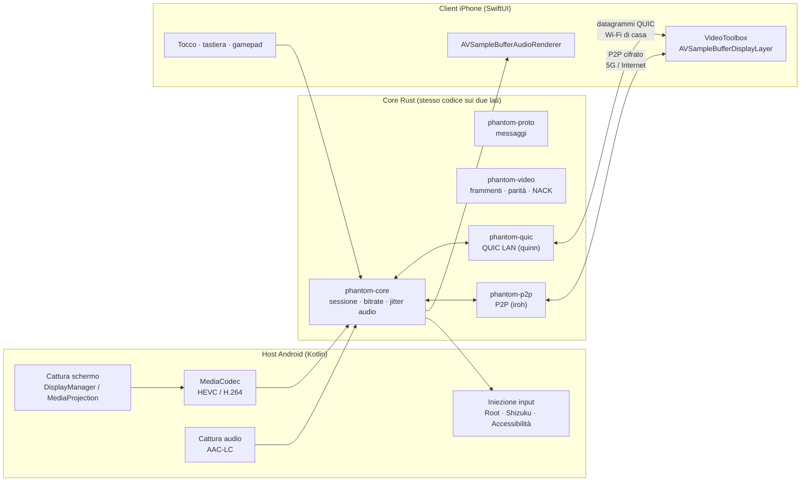

<div align="center">

# Phantom

**Il tuo telefono Android, sull'iPhone.** Controllo remoto nativo a bassa latenza: in casa via QUIC sulla rete
locale, fuori casa via P2P cifrato, fino a 120 fps con video HEVC/H.264, audio, multi-touch e tasti di sistema.

[](https://github.com/zChronoX/Phantom/releases/latest)
[](https://github.com/zChronoX/Phantom/actions/workflows/core.yml)
[](https://github.com/zChronoX/Phantom/actions/workflows/android-app.yml)
[](https://github.com/zChronoX/Phantom/actions/workflows/ios.yml)


</div>

---

## Indice

- [Cos'è](#cosè)
- [Funzionalità](#funzionalità)
- [Come funziona](#come-funziona)
- [Requisiti](#requisiti)
- [Installazione](#installazione)
- [Primo collegamento](#primo-collegamento)
- [Modalità dell'host Android](#modalità-dellhost-android)
- [Uso quotidiano](#uso-quotidiano)
- [Qualità e prestazioni](#qualità-e-prestazioni)
- [Sviluppo](#sviluppo)
- [CI e release](#ci-e-release)
- [Risoluzione dei problemi](#risoluzione-dei-problemi)
- [Privacy e sicurezza](#privacy-e-sicurezza)
- [Struttura del repository](#struttura-del-repository)
- [Crediti](#crediti)
- [Licenza](#licenza)

## Cos'è

Phantom porta lo schermo di un telefono Android su iPhone e permette di usarlo come se lo si avesse in mano: si
vede e si sente quello che succede sul telefono e lo si comanda con il tocco, la tastiera e i tasti di sistema.

È composto da tre parti che condividono lo stesso motore:

| Parte | Tecnologia | Ruolo |
| --- | --- | --- |
| **Host Android** | Kotlin, MediaCodec, nessuna libreria UI esterna | cattura schermo e audio, codifica, riceve i comandi |
| **Client iPhone** | Swift/SwiftUI, VideoToolbox, AVFoundation | decodifica e mostra il video, suona l'audio, manda tocchi e tasti |
| **Core** | Rust | protocollo, trasporti QUIC e P2P, recupero perdite, controllo del bitrate, audio anti-jitter |

Il core Rust è lo stesso sui due telefoni: è compilato per Android (`arm64-v8a`, `x86_64`) e per iPhone e collegato
alle app con binding UniFFI generati automaticamente (Kotlin e Swift).

## Funzionalità

**Video**
- HEVC (predefinito) o H.264 con encoder hardware MediaCodec, decodifica hardware VideoToolbox.
- Fino a 1080p e 120 fps: risoluzione e frequenza si adattano a quello che l'encoder del telefono regge (sul
  Redmi Note 11 Pro 5G: 864×1920 a 60 fps in HEVC).
- Qualità adattiva: bitrate che segue la rete e gradini 1080p → 720p → 540p con isteresi, per non cambiare
  risoluzione di continuo; dopo una risalita fallita la successiva aspetta di più (fino a 10 minuti).
- Recupero delle perdite: parità XOR adattiva (da 1 pacchetto ogni 10 fino a 1 ogni 3 con perdite sparse, come su
  5G), ritrasmissione su richiesta (NACK), intra-refresh e keyframe solo quando servono.

**Audio**
- Audio di sistema AAC-LC 48 kHz, decodificato in hardware sull'iPhone.
- Buffer anti-jitter nel core: i pacchetti in ritardo o duplicati non diventano scatti.

**Input e controllo**
- Multi-touch fino a 10 dita, tastiera fisica e software (HID), gamepad MFi/Bluetooth.
- Tasti di sistema: Indietro, Home, Recenti, Notifiche, Volume, Screenshot, Blocca.
- Appunti condivisi nei due versi.
- Schermo fisico del telefono spento durante l'uso remoto, e risveglio a distanza.

**Rete**
- In casa: QUIC diretto sulla rete locale, telefono trovato automaticamente con Bonjour/mDNS.
- Fuori casa (5G/4G o un altro Wi-Fi): P2P con [iroh](https://iroh.computer/), hole punching e relay cifrato quando
  serve. Niente VPN, niente porte da aprire sul router.
- Passaggio automatico Wi-Fi ↔ 5G, riconnessione automatica e ritorno in LAN appena torna disponibile.
- Host sempre raggiungibile: controlla da solo il collegamento al relay e si ripara dopo cambi di rete o blackout.

**App**
- iPhone: HUD laterale a scomparsa (linguetta con Indietro/Home/Recenti sempre a portata, pannello con controlli e
  telemetria), sessione viva in background (in silenzio e senza video, per non consumare dati), «Diagnosi» in un tocco
  con i log di iPhone e Android in un file.
- Android: tre modalità (Root, Shizuku, Standard), avvio automatico all'accensione, riquadro nelle impostazioni
  rapide, protezione termica, associazione con QR.

## Come funziona



| Crate | Cosa fa |
| --- | --- |
| `phantom-proto` | formato dei messaggi: apertura con `Hello`/`HelloAck` e funzioni negoziate, video, audio, tocco, tasti, statistiche, rapporti dell'host, log per la diagnosi |
| `phantom-video` | frammentazione dei frame, parità XOR, ritrasmissioni con budget, ricomposizione |
| `phantom-core` | sessione host/client, controllo del bitrate, scarto alla sorgente quando la rete si blocca, buffer anti-jitter audio |
| `phantom-quic` | trasporto QUIC per la LAN (quinn, BBR, datagrammi RFC 9221, certificato fissato) |
| `phantom-p2p` | trasporto P2P con iroh (NAT traversal, relay, identità persistente) |
| `phantom-clock` | sincronizzazione degli orologi per misurare la latenza |
| `phantom-netsim` | simulatore di rete per i test (perdite, ritardi, code) e modello del mittente QUIC (BBR) |
| `phantom-ffi` | binding UniFFI 0.32 per Kotlin e Swift |

Le scelte di progetto sono documentate negli ADR in [docs/adr/](docs/adr/).

## Requisiti

| | Minimo | Consigliato |
| --- | --- | --- |
| **Telefono Android (host)** | Android 8.0 (API 26), `arm64-v8a` o `x86_64` | Android 12+ (audio in tutte le modalità), encoder HEVC |
| **iPhone (client)** | iOS 17 | display ProMotion per i 120 fps |
| **Rete** | Wi-Fi di casa, o Internet su entrambi per il P2P | Wi-Fi 5 GHz, telefono vicino all'access point |

## Installazione

Le app si scaricano dalla pagina [Releases](https://github.com/zChronoX/Phantom/releases/latest). Le novità di
ogni versione sono in [CHANGELOG.md](CHANGELOG.md).

**Android**
1. Scarica `Phantom.apk` e installalo (consenti l'installazione da fonti sconosciute per il browser o il file
   manager).
2. Gli aggiornamenti si installano sopra la versione precedente: l'APK è firmato sempre con la stessa chiave.

**iPhone**
1. Scarica `Phantom.ipa`.
2. Installalo con [Sideloadly](https://sideloadly.io/), [AltStore](https://altstore.io/) o
   [SideStore](https://sidestore.io/) usando il tuo Apple ID. Con un account gratuito la firma dura 7 giorni e va
   rinnovata.

## Primo collegamento

1. Sul telefono Android apri Phantom, scegli la modalità (vedi sotto) e avvia l'host.
2. Tocca **Collega iPhone · QR**.
3. Sull'iPhone apri Phantom, tocca **+** (o **Scansiona QR**) e inquadra il codice.

Il QR contiene l'indirizzo in LAN, l'impronta del certificato, l'identità P2P e un token di accoppiamento a 128 bit:
da quel momento l'iPhone riconosce solo quel telefono, e il telefono accetta solo quell'iPhone.

## Modalità dell'host Android

| Modalità | Serve | Video e audio | Controllo dall'iPhone |
| --- | --- | --- | --- |
| **Root** | `su` (Magisk, KernelSU) | sì (audio da Android 12) | completo: multi-touch, tastiera, tasti di sistema, schermo spento |
| **Shizuku** | app [Shizuku](https://shizuku.rikka.app/) avviata con il Debug wireless (Android 11+), nessun root | sì (audio da Android 12) | completo, come Root |
| **Standard** | solo il permesso di cattura schermo | sì (audio da Android 10) | con l'**Accessibilità** di Phantom attiva: tap, swipe, pinch, tasti di sistema e testo; senza, solo visione |

**Avviare Shizuku senza root**
1. Impostazioni → Opzioni sviluppatore → attiva **Debug wireless** (il telefono deve essere su una rete Wi-Fi).
2. Apri Shizuku → **Associa** con il codice di accoppiamento → **Avvia**.
3. In Phantom scegli **Shizuku** e concedi il permesso quando richiesto.

Shizuku va riavviato dopo ogni riavvio del telefono. In modalità Root e Shizuku l'host esclude Phantom
dall'ottimizzazione della batteria e prova a tenere il Wi-Fi in modalità a bassa latenza; l'esito compare nel log.

## Uso quotidiano

**Connessione.** Dalla Home dell'iPhone si tocca il telefono salvato. Phantom prova prima la LAN (indirizzo trovato
con Bonjour o salvato), poi il P2P. Nella HUD compaiono il percorso (`LAN`, `P2P · diretto`, `P2P · relay`), gli FPS e
il tempo di andata e ritorno.

**HUD laterale.** La linguetta sul bordo dello schermo tiene sempre a portata Indietro, Home e Recenti; toccandola o
trascinandola verso il centro si apre il pannello con:
- tasti di sistema, volume, audio on/off, tastiera, appunti;
- schermo fisico spento/acceso e risveglio;
- **Diagnosi**: prepara un file con la telemetria, il diario della sessione dell'iPhone e il log del telefono
  Android, da condividere con il foglio di sistema;
- spostamento della HUD a destra o a sinistra e chiusura della sessione.

Il pannello si chiude toccando fuori, trascinandolo verso il bordo o con la freccia.

**Background.** Se apri un'altra app o blocchi l'iPhone, la sessione resta aperta: il telefono Android smette di
mandare il video (niente dati sprecati su 5G) e l'audio tace, a meno di attivare «Audio in background» nelle
impostazioni dell'iPhone. Al ritorno il video riparte subito da un keyframe e l'audio torna com'era. Se iOS sospende
comunque l'app, al ritorno si riconnette da sola.

**Avvio automatico.** Con l'opzione attiva nell'app Android, l'host parte da solo all'accensione del telefono e dopo
un aggiornamento: subito in Root, in Shizuku appena Shizuku è attivo. In modalità Standard (o se Shizuku non parte)
arriva una notifica che apre l'app.

**Fuori casa.** Basta che il telefono Android sia acceso con l'host avviato e connesso a Internet: l'iPhone lo
raggiunge tramite la sua identità P2P, da qualsiasi rete. Tornati a casa la sessione rientra in LAN da sola.

## Qualità e prestazioni

| Parametro | LAN | P2P |
| --- | --- | --- |
| Bitrate di partenza | 12 Mbit/s | 6 Mbit/s |
| Bitrate minimo / massimo | 3 / 32 Mbit/s | 1 / 20 Mbit/s |
| Tetto per pixel | 0,15 bit/pixel in HEVC, 0,22 in H.264 (oltre la qualità non migliora a vista) | idem |
| Coda prima dello scarto | ~600 ms (il Wi-Fi smaltisce gli arretrati in pochi ms) | ~500 ms diretto, ~250 ms via relay |

Il controllo del bitrate guarda insieme perdite, ritardo di coda misurato con i ping e stalli della coda di invio.
L'iPhone chiede di rimandare un pezzo di frame solo quando è sicuro che sia perso (è già arrivato qualcosa spedito
dopo) e durante un blocco della rete non chiede nulla: arriverà tutto insieme. Al ritorno dal background il
controllo di congestione del trasporto riparte per qualche secondo dal bitrate di prima, invece che da zero.
Quando la rete si blocca l'host non accumula secondi di ritardo: salta i frame, svuota la coda e riparte da un solo
keyframe. La HUD espansa mostra tutto quello che serve per capire come sta andando: latenza p50/p95, tempo di
codifica, RTT, Mbit/s ricevuti e obiettivo, frame persi e saltati, keyframe, stato dell'audio e termico.

## Sviluppo

Il PC di sviluppo non ha bisogno di Xcode: l'app iPhone si compila nella CI su macOS.

**Core Rust** (MSRV 1.91)
```bash
cd core
cargo test --workspace --release
cargo fmt --all -- --check
cargo clippy --workspace --all-targets -- -D warnings
```

**Binding UniFFI**
```bash
cd core
cargo build -p phantom-ffi --release
cargo run -p uniffi-bindgen --release -- generate \
  --library target/release/libphantom_ffi.so --language kotlin --out-dir ../android/app/app/src/main/java
cargo run -p uniffi-bindgen --release -- generate \
  --library target/release/libphantom_ffi.so --language swift --out-dir ../ios/build/rust/swift
```

**Host Android** (Android Studio o Gradle, AGP 8.7, Kotlin 2.0, compileSdk 35)
```bash
cd android/app
gradle testDebugUnitTest assembleRelease   # il repository non include il Gradle wrapper
```
Le librerie native `libphantom_ffi.so` per `arm64-v8a` e `x86_64` si compilano con l'NDK: i comandi esatti sono nel
workflow [android-app.yml](.github/workflows/android-app.yml).

**Client iPhone** (macOS con Xcode)
```bash
cd ios
./build-ipa.sh        # core Rust per iOS, binding Swift, progetto con XcodeGen, IPA
./Tests/run-tests.sh  # test della logica senza UIKit (funzionano anche con Swift su Linux)
```

Regole del repository per chi contribuisce: [AGENTS.md](AGENTS.md). Stato e prossimi passi: [PROGRESS.md](PROGRESS.md)
e [HANDOFF.md](HANDOFF.md).

## CI e release

| Workflow | Cosa fa |
| --- | --- |
| [core.yml](.github/workflows/core.yml) | test, formattazione e clippy del core Rust |
| [android-app.yml](.github/workflows/android-app.yml) | binding Kotlin, librerie native, test JVM, APK firmato |
| [ios.yml](.github/workflows/ios.yml) | test Swift, core per iOS, IPA |

Per pubblicare una versione:
1. aggiorna `versionName` in `android/app/app/build.gradle.kts` e `MARKETING_VERSION` in `ios/project.yml`;
2. aggiungi la sezione `## [x.y.z]` in [CHANGELOG.md](CHANGELOG.md) e verifica con
   `bash tools/release/check-version.sh vx.y.z`;
3. commit e push su `main`, poi `git tag vx.y.z` e `git push origin vx.y.z`.

La CI controlla che tag, versioni e changelog coincidano, pubblica `Phantom.apk` e `Phantom.ipa` nella release e usa
la sezione del changelog come note. La chiave di firma dell'APK si crea una volta con
`tools/release/create-keystore.ps1`.

## Risoluzione dei problemi

| Sintomo | Cosa fare |
| --- | --- |
| L'iPhone non trova il telefono in casa | Stessa rete Wi-Fi per entrambi; sull'iPhone consenti a Phantom l'accesso alla rete locale (Impostazioni → Privacy e sicurezza → Rete locale). Se il router isola i client Wi-Fi, il collegamento passa dal P2P. |
| Fuori casa non si collega | Sul telefono l'host deve essere avviato e online: nel log cerca «P2P integrato (iroh) online» o «P2P di nuovo raggiungibile». |
| Scatti o immagine che si ferma a intervalli | Nel log Android cerca le righe «Rete in affanno»: un RTT QUIC che sale molto e pacchetti persi indicano un Wi-Fi disturbato. Meglio il 5 GHz, telefoni vicini allo stesso access point, niente powerline o ripetitori in mezzo. |
| Shizuku non parte dopo un riavvio | Riattiva il Debug wireless e riavvia Shizuku. |
| In modalità Standard i tocchi non funzionano | Attiva l'Accessibilità di Phantom nelle impostazioni Android. |
| «Schermo Off» non spegne lo schermo | Serve la modalità Root o Shizuku; il motivo esatto è nella stessa riga del log. |
| Serve aiuto | HUD → **Diagnosi**: il file contiene i log dell'iPhone e del telefono Android. |

## Privacy e sicurezza

- **Nessun server di Phantom.** I dati vanno direttamente da un telefono all'altro.
- **Tutto cifrato.** In LAN QUIC con TLS 1.3 e certificato dell'host fissato al momento dell'associazione; in P2P
  connessioni iroh cifrate end-to-end e autenticate con la chiave del telefono.
- **Solo il tuo iPhone.** Ogni sessione deve presentare il token di accoppiamento a 128 bit del QR, confrontato in
  tempo costante.
- **Relay e scoperta P2P.** Fuori casa iroh usa i relay pubblici di n0 solo quando il collegamento diretto non è
  possibile e pubblica l'indirizzo del telefono sul suo servizio di scoperta: il traffico che passa dal relay resta
  cifrato e il relay non lo può leggere.
- **Diagnosi.** Il file contiene solo dati tecnici (modelli, versioni, tempi, contatori, log); lo condividi tu, se e
  con chi vuoi.

## Struttura del repository

```
android/app/     host Android in Kotlin (Root, Shizuku, Standard + Accessibilità)
core/            core Rust: protocollo, video, sessione, QUIC, P2P, binding UniFFI
ios/             client iPhone in Swift/SwiftUI (progetto XcodeGen in ios/project.yml)
docs/adr/        decisioni architetturali (ADR-001 … ADR-011)
docs/            design system e documentazione
tools/           preflight del repository e script di release
.github/         workflow di CI e release
```

Il codice della prima fase (modulo Magisk, sonda C, strumenti basati su scrcpy) è archiviato nel branch
`archive/legacy-f0`.

## Crediti

- [scrcpy](https://github.com/Genymobile/scrcpy) di Genymobile: le tecniche di cattura dello schermo e dell'audio
  e di accesso alle API di sistema su Android 14–17 si ispirano al suo server.
- [iroh](https://github.com/n0-computer/iroh) di n0: connettività P2P, hole punching e relay.
- [quinn](https://github.com/quinn-rs/quinn) e [rustls](https://github.com/rustls/rustls): QUIC e TLS.
- [UniFFI](https://github.com/mozilla/uniffi-rs) di Mozilla: binding Kotlin e Swift.
- [Shizuku](https://github.com/RikkaApps/Shizuku) di RikkaApps: privilegi di sistema senza root.
- [ZXing](https://github.com/zxing/zxing): generazione dei QR di associazione.

## Licenza

Il progetto non ha ancora una licenza: finché non ne viene scelta una, tutti i diritti sono riservati all'autore.
